# Rock Band General Helper

← [Back to overview and installation](../README.md)

**Utility actions for custom song authoring in REAPER.** A REAPER ReaScript covering stem import and audio alignment, a per-project workflow checklist, VENUE/EVENTS track generation, and genre/difficulty-rank suggestions, spread across five always-visible tabs plus one experimental (work-in-progress) tab.

The instrument tools — Difficulty, Overdrive, Tab Input and MIDI — are in the **[Instrument Helper](../rock_band_instrument_helper_vkr/README.md)**.

---

## Quick start

1. Open a REAPER project with your audio stems already imported.
2. Run the script. The window opens with five tabs: **General | Workflow | Events | Venue | Metadata**, plus the WIP tab below.
3. Try General → Actions → **Align all audio** to line up your stems, or jump straight to **Venue** to start authoring VENUE/EVENTS events.
4. **Tempo Map** is experimental and hidden by default — enable it via General → Settings → **Show WIPs?** (see [README_WIP.md](README_WIP.md) for its full documentation).

---

## UI overview

The window is organized into tabs plus a status panel at the bottom. Five tabs are always visible; one more (Tempo Map) is work-in-progress and hidden until enabled.

| Tab            | Purpose                                                                              |
| -------------- | ------------------------------------------------------------------------------------ |
| **General**    | Stem import, audio alignment, song fade out, settings save/load, and buttons that open the other tools |
| **Workflow**   | A per-project authoring checklist from a template you can edit                      |
| **Events**     | List the song sections and insert EVENTS-track markers at the playhead               |
| **Venue**      | Validate and generate text events on the VENUE track                                |
| **Metadata**   | Convert a real-world genre to the closest supported Rock Band genre, and suggest a difficulty rank and tier for each finished Expert chart |

<a id="wip-tabs"></a>

| WIP tab (hidden by default) | Purpose                                                            |
| ---------------------------- | ------------------------------------------------------------------ |
| **Tempo Map**                | Detect BPM from drum audio and generate REAPER tempo markers measure-by-measure |

It functions at a basic level but has known issues and isn't ready for general use. Enable it via **Show WIPs? = Yes** in General → Settings; it appears after Metadata in the tab bar. Full documentation for it (including Tips, Troubleshooting, and Known limitations) lives in **[README_WIP.md](README_WIP.md)**. The Drums, Keys and Guitar WIP tabs moved to the [Instrument Helper](../rock_band_instrument_helper_vkr/README_WIP.md).

The bottom of the window always shows the active time selection (or "No time selection") and the result panel from the last action.

---

## General tab

Contains three sub-tabs: **Actions**, **Settings**, and **Other tools**.

### Actions sub-tab

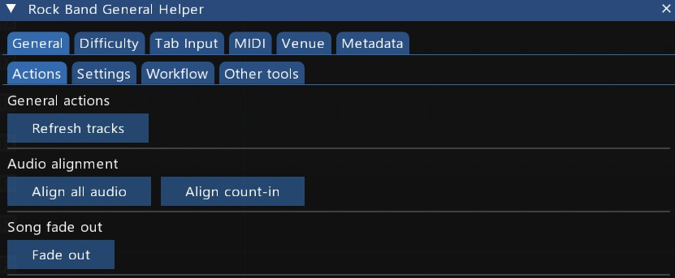

#### Refresh tracks

Re-scans the project's track list to pick up any tracks added or renamed after the script opened.

#### Audio alignment

##### Align all audio

Moves every single-item audio track in the project to start at the same position as the **SONG AUDIO** track. Useful when drum and instrument stems were exported separately and landed at different positions.

- Tracks with zero audio items (MIDI tracks, empty tracks) are silently skipped.
- Tracks with multiple audio items are skipped and listed in the result.
- **COUNT IN** is always excluded — use **Align count-in** for that track.
- Fully undoable.

##### Align count-in

Positions **COUNT IN** clips at the standard count-in beat slots derived from the project's root tempo marker time signature:

| Time sig   | Slots                                         |
| ---------- | --------------------------------------------- |
| 4/4        | m1 beats 1, 3 → m2 beats 1, 2, 3, 4 (6 clips) |
| 3/4        | m1 beat 1 → m2 beats 1, 2, 3 (4 clips)        |
| Other even | m1 beat 1 + midpoint → m2 all beats           |

Clips beyond the 6-slot cap are left untouched and listed in the result. Fully undoable.

#### Song fade out

**Fade out** creates a volume fade on the **SONG AUDIO** track (not the master track) spanning the current time selection — a time selection is required. The fade starts at the track's existing volume level at the selection start and reaches silence at the selection end. Any existing envelope points inside the selection are replaced; points outside it are untouched. Fully undoable.

The result panel adds a heads-up if the selected range looks unusual for a game fade out: under 2 seconds ("likely to sound like a cut"), 5–8 seconds ("on the longer side"), or over 8 seconds ("quite long"). Pick a range that starts at a musically meaningful point (e.g. the end of the last vocal phrase) for the most natural-sounding cutoff.

### Settings sub-tab

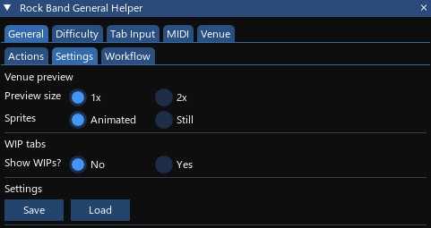

**Venue preview** — the default preview size (1×/2×) and sprite display mode (Animated/Still), shared with the Venue → Preview sub-tab and the standalone Venue Preview window (see [below](#standalone-venue-preview)).

**Show WIPs?** — toggles whether the Tempo Map tab appears (see [WIP tabs](#wip-tabs)). Default No.

**Save** writes the current slider values to the project using REAPER's project state. **Load** restores them. Settings are loaded automatically when the script opens (if a save exists) and when you switch REAPER project tabs.

**What is saved:** all Tempo Map sliders and the override checkbox.

**What is not saved:** track selections. The script re-detects KICK, SNARE, KIT, and Fallback tracks by name on each open and project switch.

### Other tools sub-tab

Buttons that open the other tools in this set, so you don't have to go back to REAPER's Actions list to switch between them. Two groups:

- **Main tools** — Instrument Helper, Vocal Helper, Music Theory Helper.
- **Standalone windows** — Venue Preview, Pitch Tuner, MIDI Pattern.

Each opens in its own window and runs independently of this one — closing the General Helper doesn't close them, and they keep their own settings. The General Helper itself isn't listed, since you're already in it.

Opening a tool for the first time also **registers it in REAPER's Action list**, which is what lets you give it a keyboard shortcut or a toolbar button afterwards (**Actions → Show action list**, then search for its name). It's never removed again — un-registering would delete the entry along with any shortcut you'd bound to it, and re-adding it later produces a different internal ID, so the shortcut couldn't be restored. Clicking a tool that's already open just says so instead of opening a second copy.

A tool that isn't installed next to this script is greyed out with a note saying which file is missing, rather than failing when you click it. Put the `.lua` files back in one folder and the button re-enables on its own within a couple of seconds — no need to restart the script.

---

## Workflow tab

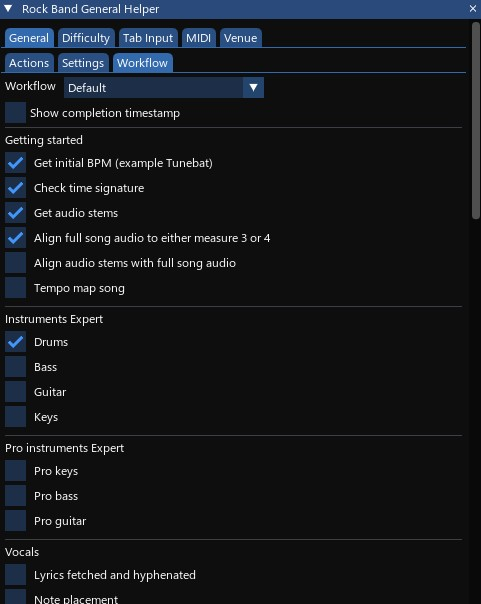

A per-project authoring checklist: a list of steps, grouped into sections, that you check off as you finish them — handy for picking up where you left off after a break, or when juggling several songs at once. The checklist comes from a plain-text template file, so you can tailor the list of steps to how you actually work (e.g. a shorter checklist for an instrumental song with no vocals).

### Choosing a template

**Workflow** combo — pick a `.txt` file from `resources/workflow/`. The script ships with one starter template, `Default.txt`, covering a typical full-band song end to end. If the folder has no `.txt` files, the tab shows a disabled hint instead. If your saved project doesn't have a template selected yet (first use, or the file it had selected was deleted), a template literally named `Default` is picked automatically; if there's no `Default`, the first template alphabetically is used instead.

**Show completion timestamp** — checkbox, off by default. When on, a checked item shows "Completed on dd.MM.yyyy at hh:mm" underneath it. The timestamp is recorded the moment you check an item either way — this checkbox only controls whether it's displayed.

**Show only unfinished** — checkbox, off by default. When on, checked items are hidden so you can focus on what's left; a section whose every item is checked disappears entirely. Nothing is lost — turn the checkbox back off to see everything again.

A **progress line** ("10 / 40 completed - 25%") sits below the checkboxes once a template is selected, counting the whole template regardless of whether "Show only unfinished" is hiding some of it.

### Checking off items

Click the checkbox or the item's label text to toggle it — both work. Checking an item saves immediately to the project (its own save slot, independent of this tab's own Save/Load buttons below), so you don't need to remember to hit Save before closing REAPER. Unchecking an item clears its recorded time.

Checked state is tracked per **section + item**, not by the item's text alone — so if two different sections both have a step called "Guitar" (as the starter template does, under both "Instruments Expert" and "Difficulty reductions"), checking one doesn't check the other.

If you switch to a different template, any step whose section heading *and* step text match exactly what you had checked before carries its checked state and timestamp over. Anything reworded, moved to a different section, or new to the template starts unchecked — you decide whether to re-check it.

### Writing your own template

A template is a plain `.txt` file in `resources/workflow/`, one entry per line:

| Line looks like            | Becomes                                                                 |
| --------------------------- | ------------------------------------------------------------------------ |
| `[Section Name]`            | A section heading — not checkable, just groups the steps under it.      |
| `Some step`                 | A checkable step.                                                        |
| `Some step {a hint}`        | A checkable step with a hover tooltip ("a hint"), stripped from the label. |
| `{a hint}` on its own line  | Attaches as the tooltip to the step on the line right above it.         |

Copy `Default.txt` as a starting point and rename/reorder/add/remove lines freely — the checklist rebuilds from whatever's in the file the next time you select it.

A couple of edge cases are handled predictably rather than guessed at:

- If a step somehow ends up with more than one tooltip attached (e.g. it already has a same-line `{...}` *and* a `{...}` line follows it, or it has two `{...}` groups on the same line), the tooltip is dropped rather than picking one arbitrarily.
- The tab warns you (above the checklist) if a template file has the same step repeated twice under the same section — almost always a copy-paste slip — or if its `[` / `]` or `{` / `}` brackets don't balance, which usually means a bracket got deleted or mistyped somewhere in the file. Both are just warnings; the rest of the file still loads.

Switching templates (via the combo) immediately drops checked history for any step that doesn't match the newly-selected template — only whichever template is currently selected keeps its checked state around. If a step's section+label happens to match between the old and new template it survives the switch (see [Checking off items](#checking-off-items) above); anything else is gone, including if you switch back later. Keep this in mind if you're bouncing between two templates for the same song — history isn't retained per-template, only for whichever one is currently selected.

---

## Events tab

Works on the **EVENTS** track: the song sections and markers that Venue's section-based generation and the game read. Contains two sub-tabs: **General** and **Manual gen**.

### General sub-tab

**List event sections** reads `[prc_*]` markers from the EVENTS track and lists all detected song sections with time ranges. Letter-suffix variants (`[prc_verse_1a]`, `[prc_verse_1b]`) are merged into a single section entry.

### Manual gen sub-tab

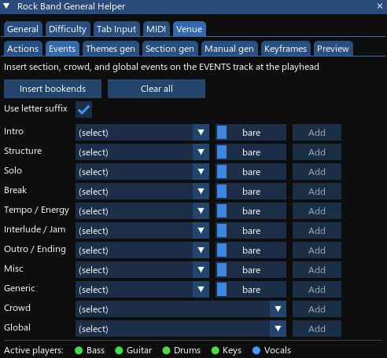

Inserts section, crowd, and global marker events on the EVENTS track at the playhead.

- **Use letter suffix** checkbox (default on) — when on, **Add** inserts only lettered part forms (`[prc_verse_1a]`, then `[prc_verse_1b]`, …), used to split a long section into parts that merge back into one section in Section gen. When off, Add inserts only the plain form and refuses if it already exists. Events with no lettered variants (e.g. `[prc_bre]`) always insert the plain form either way.
- One row per event group — **Intro, Structure, Solo, Break, Tempo/Energy, Interlude/Jam, Outro/Ending, Misc** (numbered `[prc_*]` section markers), **Generic** (`[prc_a]`–`[prc_k]`, lettered-only, for parts that fit no named category), **Crowd** (`[crowd_*]`), and **Global** (`[music_start]`, `[music_end]`, `[end]`, `[coda]`). Each row has a base-name combo, a number stepper where applicable, a live `-> <event>` indicator showing exactly what the next Add will insert (or `-> (blocked)` with the reason on hover), and an **Add** button.
- Inserts are validated: no duplicates (reports the existing event's location), no mixing plain and lettered forms of the same event, numbers/letters must be used in sequence, and only one text event per position (crowd events are exempt and may stack anywhere).
- **Insert bookends** removes any existing instances of the six bookend events, then inserts the minimal per-song set: `[prc_intro]` + `[crowd_normal]` at measure 1, `[music_start]` at measure 3, and `[prc_outro]`/`[music_end]`/`[end]` near the end of the song. Skips the end trio on items under 7 full measures; occupied target spots are skipped and reported.
- **Clear all** removes every text event from the EVENTS track (the track-name event itself is kept).

All Events actions are fully undoable.

---

## Venue

The Venue tab contains six sub-tabs, in this order: Actions, Themes gen, Section gen, Manual gen, Keyframes, Preview. (The EVENTS-track tools moved to the [Events tab](#events-tab) in v0.9.63.) The script finds the VENUE and EVENTS tracks automatically by name — no dropdown needed.

An **Active players** row is shown below every sub-tab (see [below](#active-players-row)).

### Actions sub-tab

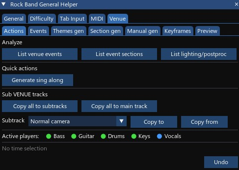

Inspection and utility actions that don't fit the generation sub-tabs.

**List venue events** audits all MIDI text events on the VENUE track against the Rock Band Network specification. It reports:

- **Track name event** — whether a single `"VENUE"` type-3 event exists at PPQ 0.
- **Unknown events** — text events not in the RBN spec; these cause compile errors.
- **Consecutive camera repeats** — the same directed or coop shot used back to back.
- **Directed cut spacing** — directed cuts within 2 s of the next camera event.
- **Camera gap statistics** — average, slowest, and fastest cut durations for coop→any and directed→coop transitions.
- **Event frequency count** — how many times each event is used, sorted by frequency.

**List lighting/postproc** finds every `[lighting*]` and `*.pp]` (postproc) text event on the VENUE track and lists them in timeline order of appearance, each with its measure/timestamp location.

**Validate lighting/blends** checks the lighting and post-process authoring on the VENUE track — the keyframe and blend rules described below. It's read-only: it never changes the track, it just tells you what it found and what to do about it.

*Keyframes.* A `[first]` is a manual lighting event's own opening keyframe, so it belongs on that event's **exact tick**. The check reports:

- **Manual lighting changes missing a `[first]`** — a manual preset (`verse`, `chorus`, `manual_cool`, `manual_warm`, `dischord`, `stomp`) that starts running where a different one was running before.
- **`[first]` events off a lighting change** — every `[first]` that isn't on such an event, each with the reason and the fix: *move it* when it's within a beat of a change that's missing one (so fixing the first list doesn't leave you with two), or *delete it* when it sits on a blend anchor, on an automatic preset (which takes no keyframes), on a tick with no lighting event at all, or is a second copy on a tick that already has one.

An event that repeats the preset already running gets no `[first]` and is never flagged for lacking one — see blending below.

*Blending.* By default a preset change is a **hard cut**: the new lighting snaps in at its event. To make it fade instead, the **outgoing** preset is restated a beat or two before the change, giving the game something to interpolate from:

```
m3     [lighting (stomp)]  [first]
m9 b4  [lighting (stomp)]              <- blend anchor: the OLD preset, restated
m10    [lighting (verse)]  [first]     <- the change itself never moves
```

The anchor is just a duplicate of the preset that's already playing, so it starts no new keyframe train — the `[first]` at m3 keeps running straight through it. Post-process events blend the same way, independently of lighting.

The check lists **lighting changes** and **post proc changes with no blend anchor**, each naming the outgoing preset and where it started, so you know what to restate and where. A hard cut is a perfectly valid choice, so treat this as a list of places a fade *would* need an anchor rather than a list of mistakes. To add one, park the playhead a beat or two before the change and use **Blend** on the Manual gen sub-tab; the generation sub-tabs place them automatically from a theme's `lightpreset_blendin` / `postproc_blendin`.

The whole track is always read — deciding whether an event is a change, and whether an anchor precedes it, needs the events before it — but if a time selection is active only issues inside it are reported, so you can work through a song a section at a time.

**Generate sing along** derives VENUE sing-along notes for the guitarist (pitch 87, from HARM2) and bassist (pitch 85, from HARM3) out of each harmony track's vocal phrases, merging phrases less than a measure apart into one continuous note. Only the pitch of a harmony track that's present and unmuted is touched — a muted or missing source is left alone. Always processes the whole song. Fully undoable.

**Sub VENUE tracks** splits VENUE's events across 6 category tracks for easier authoring once a song has accumulated a lot of keyframes, then merges them back:

- **Copy all to subtracks** creates (if missing) "VENUE normal camera", "VENUE directed camera", "VENUE lighting", "VENUE keyevents", "VENUE post proc", and "VENUE special", each with a MIDI item matching VENUE's own position/length, placed directly after VENUE. Newly created tracks start muted — this split is an editing convenience with no meaning to the exported song, and muting keeps the software that packages the final MIDI/audio from flagging them as unrelated/unused — and inherit VENUE's custom MIDI note names, plus a take named after the track so open MIDI editor tabs are identifiable instead of all showing as "MIDI take". VENUE's own MIDI notes (e.g. the sing-cue notes) land on "VENUE special" alongside its text events, the only category that ever carries notes. Safe to re-run any time to re-sync after editing VENUE directly.
- **Copy all to main track** does nothing (with a status message) if none of the 6 subtracks exist yet. Otherwise clears VENUE and replaces it with the combined contents of however many subtracks currently exist, including "VENUE special"'s notes. Prompts for confirmation first, since it overwrites the track authoring actually reads from.
- The **Subtrack** dropdown plus **Copy to** / **Copy from** buttons work on one category at a time. Copy to clears just that subtrack and copies the matching events from VENUE into it, creating the subtrack if needed. Copy from clears only that category's events from VENUE (not everything) before copying the subtrack's contents in, but — unlike Copy to — won't create a missing subtrack. For Special, both directions also carry VENUE's MIDI notes along with its text events.
- All of the above always process the whole song. Fully undoable.

### Themes gen sub-tab

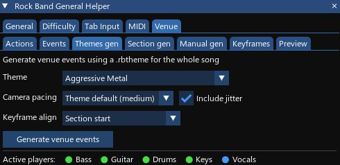

Whole-song generation driven by a `.rbtheme` file.

- **Theme** — select a `.rbtheme` file from the `resources/themes/` folder. Shows `(select a theme)` when none is loaded; Generate is disabled until a theme is chosen. If the folder is empty, all inputs are disabled.
- **Camera pacing** — override the theme's camera cut rate, or keep the theme default. A jitter toggle adds ±20 % randomisation to cut intervals for a more natural feel.
- **Keyframe align** — global alignment mode for `[first]`/`[next]` keyframe events. Options: Section start, Closest beat, Downbeat, and five instrument-aware modes (Guitar notes, Bass notes, Keys notes, Drum kicks, Drum snare) that place `[next]` only at beats where notes exist on the corresponding PART track.
- **Generate venue events** — generates camera cuts, lighting changes, manual-lighting keyframes, and post-process effects on the VENUE track. Camera pools are filtered by which PART instrument tracks are present and unmuted. Respects time selection (partial regeneration). Fully undoable.

A section never re-states the lighting or post proc preset already running. If a section's theme pool offers alternatives, it picks one of those instead; if the pool holds only the running preset, that section simply keeps it and writes no event at all (the report counts these as *Kept running preset*). This matters because two identical events back to back is exactly how a blend anchor is written — a repeat would read as a fade you never asked for. Its keyframes are still generated, so a manual preset keeps animating across the boundary. If you genuinely want a duplicate, add it with **Blend** on the [Manual gen sub-tab](#venue-manual-gen).

### Section gen sub-tab

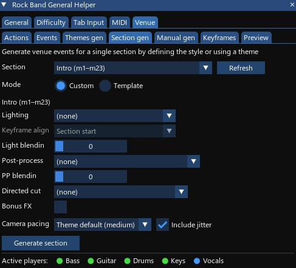

Per-section manual configuration. Sections are read from `[prc_*]` markers on the EVENTS track.

- **Section selector** — pick a song section. **Refresh** re-reads sections from the EVENTS track.
- Per-section settings:
  - **Lighting** — lighting preset for this section (manual or auto).
  - **Keyframe align** — alignment mode for `[first]`/`[next]` events (disabled for auto/no lighting).
  - **Keyframe rate** — how often `[first]`/`[next]` events are placed (beats).
  - **Light blendin** — place the lighting event N beats before the section start.
  - **Post-process** — post-process effect for this section.
  - **PP blendin** — place the post-process event N beats before the section start.
  - **Directed cut at start** — insert a forced directed camera cut at the section start.
  - **Bonus FX** — insert a `[bonusfx]` event at the section start.
- **Camera pacing** — camera cut rate override for the generated section.
- **Generate section** — generates events for the selected section only. Fully undoable.

Like Themes gen, this never re-states a preset that's already running: in Template mode the roll avoids it, and if your chosen Lighting or Post-process is the one already playing the event is skipped and the report says which preset it kept. Keyframes are still generated either way.

<a id="venue-manual-gen"></a>

### Manual gen sub-tab

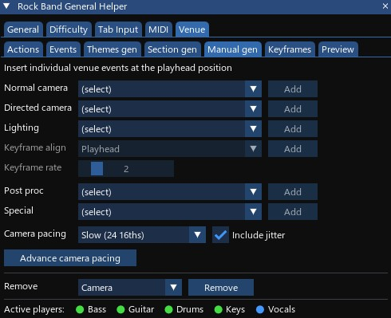

Shot-by-shot event insertion at the edit cursor.

- **Normal camera** — pick any `[coop_*]` shot; **Add** inserts it at the edit cursor.
- **Directed camera** — pick any `[directed_*]` shot including BRE events; **Add** inserts it.
- **Lighting** — pick any lighting preset; **Add** inserts `[lighting (name)]`. When a manual preset is selected, Keyframe align and Keyframe rate controls appear.
- **Post proc** — pick any `[*.pp]` effect; **Add** inserts it.
- **Special** — `[bonusfx]`, `[bonusfx_optional]`, `[first]`, `[next]`, `[previous]`; **Add** inserts the chosen event.
- **Camera pacing** — shared camera pacing override (same state as the other gen tabs).
- **Advance camera pacing** — moves the edit cursor forward by one jittered camera interval.
- **Generate keyframes** — generates `[first]`/`[next]` from the cursor to the next lighting event, time selection end, or VENUE item end. Clears existing keyframe events in the range first. Only available when a manual lighting preset is selected. Fully undoable.
- **Remove** — category dropdown (Camera / Lighting / Post proc / Special / All) + **Remove** button; removes matching events from the time selection (if active) or the full song. Fully undoable.

### Keyframes sub-tab

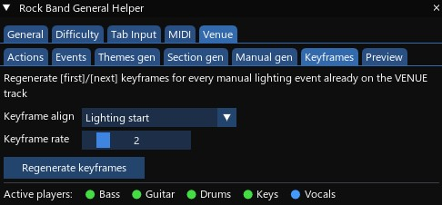

Bulk-regenerates `[first]`/`[next]` keyframes for every manual lighting event already sitting on the VENUE track — useful after moving or retiming a section rather than re-adding keyframes by hand.

- **Keyframe align** — alignment mode: **Lighting start** (default, anchors at the lighting event itself), **Closest beat**, **Downbeat**, or five instrument-aware modes (**Guitar notes**, **Bass notes**, **Keys notes**, **Drum kicks**, **Drum snare**) that place `[next]` only at beats where notes exist on the corresponding PART track.
- **Subdivision** — Every beat / Every half beat / Every quarter beat, shown only for the instrument-aware align modes.
- **Keyframe rate** — this tab's own rate (beats), independent of Section gen's and Manual gen's.
- **Regenerate keyframes** — finds every manual lighting event on VENUE (`verse`, `chorus`, `manual_cool`, `manual_warm`, `dischord`, `stomp`), and for each one inside the processing range, clears and regenerates its `[first]`/`[next]` running from that lighting event to the next lighting event of any kind. Only keyframe events are touched — camera, lighting, postproc, and bonus FX are left alone. Respects time selection (a section already in progress from before the selection is left untouched); otherwise processes the whole song. Fully undoable.

### Preview sub-tab

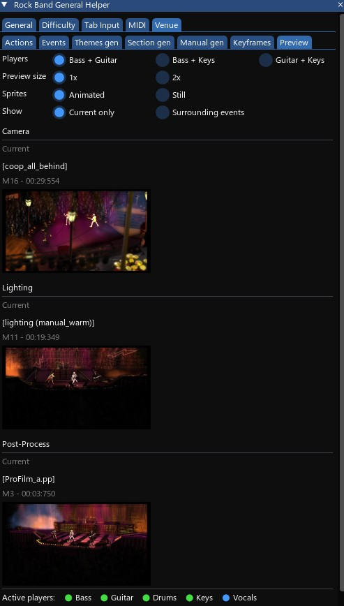

Live readout of current, previous, and next venue events relative to the playhead (or edit cursor when stopped). Updates automatically when the VENUE track changes.

- **Players** — select which two instruments are in the lineup (Bass + Guitar, Bass + Keys, Guitar + Keys). Camera shots requiring the absent instrument are shown with an alternative event, or highlighted in red if no alternative exists at that position.
- **Preview size** — inline sprite display scale: 1× (213×120 px) or 2× (426×240 px).
- **Sprites** — Animated (plays through all frames) or Still (single middle frame).
- **Show** — Current only (one column) or Surrounding events (Previous / Current / Next columns).

**Blends.** A blend is authored by re-stating the running lighting or post proc preset a beat or two before the change, so the game fades between the two instead of cutting. That re-stated copy is not a preset of its own, so the preview never shows it as an event — you'd otherwise see the same preset twice across two columns. Instead each lighting and post proc card gets a line saying how it hands over:

- **blends into next** — an anchor is present, the game will fade.
- **blending now** — the playhead is inside that fade right now.
- **hard cut to next** — no anchor, the game switches instantly. Perfectly valid, not an error.

Camera cards never show this line; a camera cut never fades. To add an anchor by hand, use **Blend** on the [Manual gen sub-tab](#venue-manual-gen); to find changes that don't have one, use **Validate lighting/blends** on the [Actions sub-tab](#actions-sub-tab).

Sprite previews require JPEG spritesheets installed under `resources/img/spritesheets/`. If no spritesheets are found, event names are shown as text with no image.

If the VENUE track is large and reading takes more than 150 ms, auto-refresh pauses automatically. A **Resume auto-refresh** button appears to re-enable it.

<a id="active-players-row"></a>

### Active players row

Shown below every Venue sub-tab (and in the [standalone Venue Preview window](#standalone-venue-preview)): a colored dot per instrument (Bass, Guitar, Drums, Keys, Vocals) shows its play state at the current playhead (playback) or edit cursor (stopped) — exactly what venue generation would treat that instrument as at that point:

- **Green** — active (`[play]`/`[mellow]`/`[intense]`)
- **Blue** — idle (`[idle]`/`[idle_realtime]`)
- **Red** — track is muted or missing, so it's excluded from venue generation
- **Orange** — no `[play]`/`[idle]` events found on the track; treated as always active

Hover a dot for the exact state and how long it's held.

<a id="standalone-venue-preview"></a>

### Standalone Venue Preview

`rock_band_preview_vkr.lua` (repo root) is a separate script that opens just the Preview sub-tab and Active players row in their own window — load it the same way as the main scripts (**Actions → Show action list → Load ReaScript**). Handy for keeping the preview visible in its own window next to the generation tabs instead of switching tabs back and forth. Same underlying behavior as Venue → Preview above.

### Validated event categories

The VENUE spec includes three categories of events:

| Category            | Examples                                                           |
| ------------------- | ------------------------------------------------------------------ |
| **Camera cuts**     | `[coop_all_near]`, `[directed_drums]`, `[directed_vocals_cls]`, …  |
| **Post-processing** | `[bloom.pp]`, `[film_b+w.pp]`, `[video_trails.pp]`, …              |
| **Lighting**        | `[lighting (verse)]`, `[lighting (frenzy)]`, `[lighting (bre)]`, … |

---

## Metadata tab

Contains two sub-tabs: **Genre** and **Difficulty**. Both answer questions about the song as a whole rather than editing anything — neither writes to the project or creates an undo point.

### Genre sub-tab

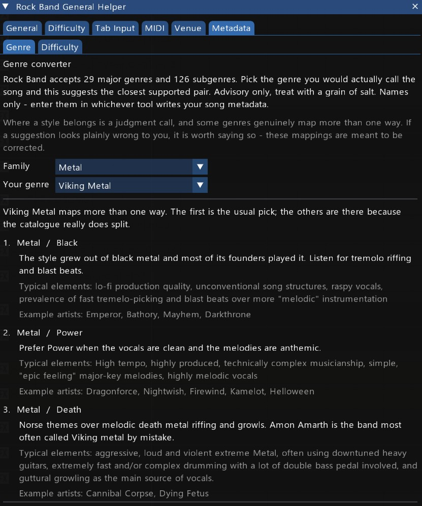

Converts the genre you'd actually call your song into the closest genre Rock Band supports.

Pick a broad **family** first, then the **genre** itself — the full list runs past 200 entries, which is more than one dropdown can be read from. Changing the family resets the genre below it.

That list is deliberately wider than what Rock Band supports. It holds styles like Djent, Easycore and Synthwave that have no supported category of their own, which is the entire reason a conversion is needed. If your genre isn't there, pick the nearest one in the same family.

The result is the closest supported **major genre and subgenre**. Some styles have more than one defensible home, and where that's true you get two or three candidates, each saying what would tip the choice toward it — real released songs in that style were genuinely filed both ways. A single suggestion means the catalogue agrees with itself and the call is settled.

A **See also** line, where one appears, points at a different entry in the *input* list rather than at another Rock Band category — Post-Grunge points at Grunge, in case your song belongs to the early-90s wave instead. It's a check on whether you picked the right input.

Two things worth knowing about the output:

- **These are display names, never `songs.dta` tokens.** Token spellings drift between game eras — RB1/RB2's `urban` became RB3's `hiphoprap`, and subgenre tokens are scoped to their parent — and the packaging tool that writes `songs.dta` has its own picker. Use that for the actual string.
- **Subgenres aren't shown in-game.** They feed the visualiser cards, so the major genre is the choice that actually matters.

The vocabulary is transcribed from the RBN/C3 subgenre documentation: 29 major genres and 126 subgenres.

### Difficulty sub-tab

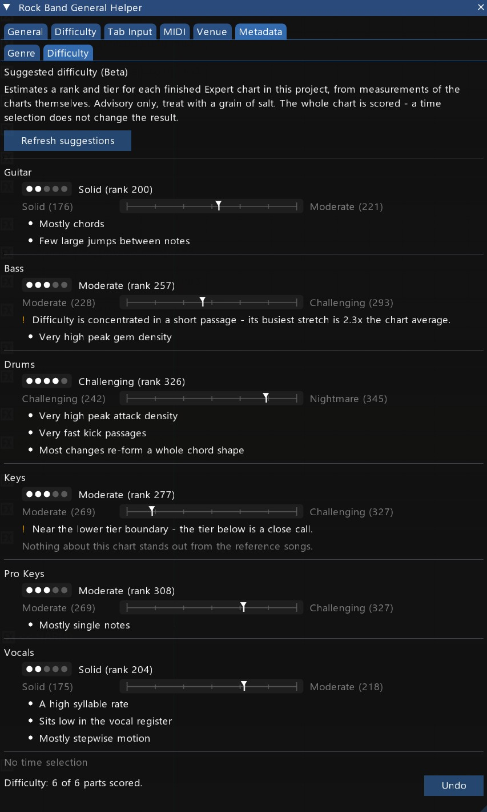

Not to be confused with the **Difficulty tab** further up, which reduces and validates charts. This one doesn't touch your notes — it estimates what *rank* each finished Expert chart would be given, and which tier that lands in.

**Where the numbers come from.** The weightings aren't one author's opinion about what makes a chart hard. Each instrument has its own model, fitted against the official ranks of around 400 released Rock Band songs read from their own `songs.dta`. The tool is trying to reproduce how the official DLC was actually ranked.

Press **Refresh suggestions** to score the project. It's read-only — nothing is written and no undo point is created. The whole chart is scored, so a time selection makes no difference, and results aren't saved with the project: re-run it after editing a chart.

Each part gets a card showing:

- **Five dots**, the way the game itself displays difficulty. Two tiers share five filled dots because that's what the game does; Impossible fills all five in red.
- **A ruler** showing where the chart landed between the tier it earned and the next one up. A tier is a threshold, so a chart sitting near either end could reasonably be called either tier, and the marker shows how much room there was. An amber marker pinned to one end means the score ran past the end of the scale and the real position is further out than the ruler can draw.
- **A few bullet points** naming the measurements on which this chart is unusual compared with the reference songs. They describe what was measured — they are not a claim about *why* the rank came out where it did.

Above the cards, anything that applies to the whole song is noted once. Currently that's the **Big Rock Ending**: Rock Band doesn't require you to play the notes authored there, but they're still counted in the suggestion, so the note says so and lets you judge.

#### How much to trust it

Guitar, bass and drums are the strongest of the six. Keys and Pro Keys are close behind.

More useful than ranking the instruments, though, is where on the scale you are. **Every part agrees most closely with the official rank through the middle of the scale**, and gets less certain toward the extremes. If a chart lands in one of the top tiers, a suggestion is more likely to read low than high — most noticeably on vocals.

It's advisory. Official ranks and player judgment can differ from each other too, so treat a suggestion as a starting point rather than a verdict.

The models are still evolving. **If a chart of yours scores clearly wrong, that's the most useful thing you can report** — see [A note on validation rules](../README.md#a-note-on-validation-rules) in the main README for where to send it.

---

## Troubleshooting

### Venue

**List venue events reports no events.**
Confirm a track named `VENUE` exists in the project. The track must have MIDI items with text events — audio items are ignored.

**Unknown events are listed but the event names look correct.**
Check for typos, extra spaces, or wrong bracket style. The validator does an exact string match against the RBN spec list.

---

For Tempo Map, Drums, Keys, and Guitar — the experimental tabs behind **Show WIPs?** — see **[README_WIP.md](README_WIP.md)**, which also has their own Tips, Troubleshooting, and Known limitations sections.
