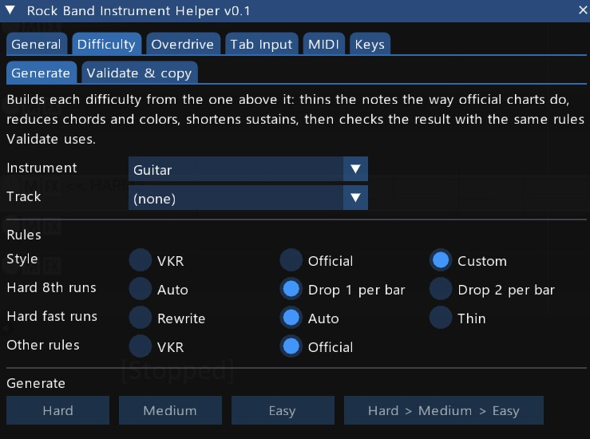
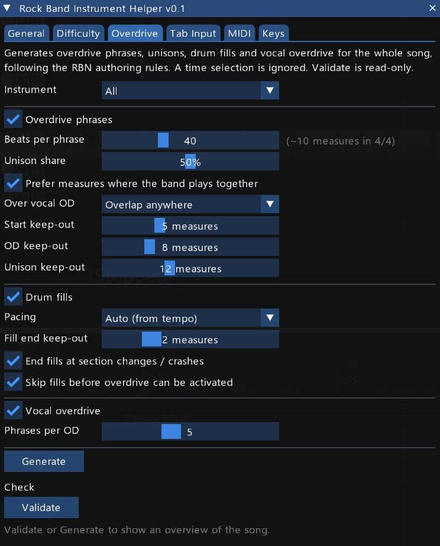
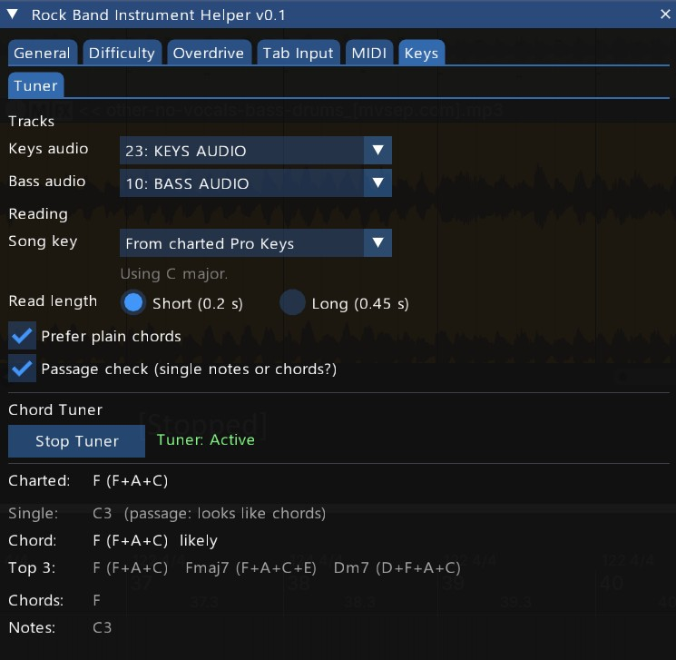

# Rock Band Instrument Helper

← [Back to overview and installation](../README.md)

**Instrument part authoring for custom songs in REAPER.** A REAPER ReaScript for the Guitar, Bass, Drums, Keys and Pro Keys parts: building and validating the lower difficulties, overdrive and drum fills, tab-input reference guides, MIDI alignment/length/pattern tools, and a chord tuner for the keys stem. Six always-visible tabs plus experimental (work-in-progress) views.

These tabs used to be part of the [General Helper](../rock_band_general_helper_vkr/README.md), which keeps the song-wide tools (audio alignment, tempo map, workflow checklist, VENUE and metadata). The two can be open side by side.

---

## Quick start

1. Open a REAPER project with your Expert charts on the usual `PART ...` tracks.
2. Run the script. The window opens with six tabs: **General | Difficulty | Overdrive | Tab Input | MIDI | Keys**.
3. Try **Difficulty → Generate** to build Hard, Medium and Easy from Expert, then check them in **Difficulty → Validate & copy**.
4. The **Drums** and **Guitar** tabs and the **Keys → WIP** sub-tab are experimental and hidden by default — enable them via General → Settings → **Show WIPs?** (see [README_WIP.md](README_WIP.md) for their full documentation).

---

## UI overview

The window is organized into tabs plus a [footer](#window-footer) that is always visible at the bottom. Six tabs are always visible; the Drums and Guitar tabs and the Keys → WIP sub-tab are work-in-progress and hidden until enabled.

| Tab            | Purpose                                                                              |
| -------------- | ------------------------------------------------------------------------------------ |
| **General**    | Remove 2x kicks, settings save/load, and buttons that open the other tools |
| **Difficulty** | Generate, copy and validate Pro Keys / Keys / Guitar-Bass / Drums tracks at each difficulty level |
| **Overdrive**  | Generate overdrive phrases, unisons, drum fills and vocal overdrive, and validate what is already authored |
| **Tab Input**  | Reference guide: parse ASCII tab notation for Guitar/Bass, Keys/Pro Keys, or Vocal  |
| **MIDI**       | Align, length-sync, or find-and-replace patterns on MIDI items                      |
| **Keys**       | Tuner: names the chord or note in the keys audio stem, for charting Pro Keys by ear |

| WIP tab (hidden by default) | Purpose                                                            |
| ---------------------------- | ------------------------------------------------------------------ |
| **Drums**                    | Convert GM MIDI drum notes to Rock Band 5-lane format               |
| **Keys → WIP** (sub-tab)     | Convert piano MIDI to Rock Band Pro Keys, 5-Lane Keys, or split into hand tracks |
| **Guitar**                   | Convert raw guitar MIDI pitches to Rock Band Expert gem notes       |

These function at a basic level but have known issues and aren't ready for general use. Enable them via **Show WIPs? = Yes** in General → Settings: the Drums and Guitar tabs appear after Keys in the tab bar, and WIP appears as a sub-tab of Keys. Full documentation for these tabs lives in **[README_WIP.md](README_WIP.md)**.

The bottom of the window always shows the active time selection (or "No time selection") and the result panel from the last action.

---

## Window footer

The bottom of the window is always visible; the tabs scroll above it, so on a short window nothing here scrolls out of sight.

- **Time selection** and the **status line** of the last action.
- **Track lists update on their own** — adding, renaming or deleting a track, or adding an item to one, shows up in the track dropdowns within about a second (audio dropdowns list only tracks with audio items, MIDI dropdowns only tracks with MIDI items). There is no Refresh button to press.
- **Copy result** — copies the status line and the result panel to the clipboard, e.g. for a bug report.
- **Undo** — undoes the last REAPER action; its tooltip names it.

The result panel of the last action is shown under the tab content, scrolling with it.

---

## General tab

Contains three sub-tabs: **Actions**, **Settings**, and **Other tools**.

### Actions sub-tab

#### Drums 2x kicks

**Remove 2x kicks** works out which kicks on **PART DRUMS_2X** are the drummer's second foot and removes those from **PART DRUMS**. PART DRUMS_2X is the complete chart — every kick, double-bass hits included — and is never thinned; PART DRUMS ends up as the same chart playable with one pedal. Author every kick on both tracks, then press it. The whole track is processed (a time selection does not narrow it), and running it again finds nothing more to remove. The button's tooltip explains exactly which kicks count as the second foot.

### Settings sub-tab

**Show WIPs?** — toggles whether the Drums and Guitar tabs and the Keys → WIP sub-tab appear (see [WIP tabs](#wip-tabs)). Default No.

**Save** writes this window's settings to the project using REAPER's project state. **Load** restores them. Settings are loaded automatically when the script opens (if a save exists) and when you switch REAPER project tabs. They are saved separately from the General Helper's, so saving in one never changes the other.

**What is saved:** the Overdrive tab's options, the Tab Input format and mode, the Difficulty tab's instrument picks, Generate's rule style, Custom options and 2x pedal checkbox, the Keys reduce checkbox, the MIDI Alignment mode and Length settings, the Keys Tuner's settings (track selections aside), the WIP tabs' options, and Show WIPs?.

**What is not saved:** track selections (they are re-detected by name on each open and project switch).

### Other tools sub-tab

Buttons that open the other tools in this set — the General Helper, Vocal Helper and Music Theory Helper, and the standalone windows — so you don't have to go back to REAPER's Actions list to switch between them. It works exactly like the [General Helper's Other tools sub-tab](../rock_band_general_helper_vkr/README.md#other-tools-sub-tab); the Instrument Helper itself isn't listed, since you're already in it.

---

## Difficulty tab

Contains two sub-tabs: **[Generate](#generate-sub-tab)**, which builds the lower difficulties automatically, and **[Validate & copy](#validate--copy-sub-tab)**, for copying and checking difficulties by hand. Both pick the instrument from an **Instrument** dropdown and follow each other: picking Drums in one shows Drums in the other (except when Generate is on All instruments).

### Generate sub-tab

<!-- TODO: screenshot of the Difficulty > Generate sub-tab -->

Builds Hard, Medium and Easy automatically, each from the difficulty above it, for **Guitar**, **Bass**, **Keys**, **Pro Keys** and **Drums** (with the song's PART DRUMS_2X). It thins the notes the way the official charts do, reduces chords and colors, shortens sustains, then checks the result with the same rules Validate uses and lists anything left to fix.

Every rule, where it comes from (the RBN documentation, the official Rock Band 3 charts, or the author's own choice) and how closely the result matches the official charts is written up in **[Difficulty reduction](../docs/difficulty_reduction.md)**.

**Instrument** — one instrument, or **All instruments**:

- One instrument shows its track row (Pro Keys: one track per difficulty; Drums: the PART DRUMS and **2X track** rows). The track is the same selection Validate & copy shows.
- **All instruments** uses each default track (PART GUITAR, PART BASS, PART REAL_KEYS_X/H/M/E, PART KEYS, PART DRUMS, PART DRUMS_2X) and skips any that is missing or muted.

Instruments that play together stay together:

- **Bass and Keys follow Guitar** in bars with the same rhythm, so the band's lower difficulties line up.
- **Keys follows Pro Keys** at the same difficulty when Pro Keys has notes; in All instruments, Pro Keys is generated first.
- **Drums are reduced on their own**, limb by limb, independent of the band.
- **Drums 2X**: each 2X difficulty plays the kicks of the PART DRUMS difficulty one step up.

**Buttons:**

- **Hard**, **Medium**, **Easy** — generate one difficulty from the one above it *as it is now*. Use these after hand-editing a difficulty, to rebuild only the ones below it.
- **Hard > Medium > Easy** — all three in one go.

**Only 2x bass pedal authored on PART DRUMS** (Drums, off by default): for a song charted only in its double-bass version, on PART DRUMS. Its lower difficulties are made the way PART DRUMS_2X's would be.

**Rules.** The **Style** row picks the set of rules Generate follows:

- **VKR** (default) — the tool author's own rules: mostly what the official charts do, with some choices of their own where a chart played better another way.
- **Official** — most of the tool author's own choices turned off, so the result is closer to the official charts. It does not chart a song the way Harmonix did: a few rules have no official version yet and stay as in VKR.
- **Custom** — pick each option yourself. Once you have used it, it keeps its own values, and saved settings bring them back. The first time, it starts from the values of the style shown before it.

With VKR and Official, the option rows show the values in use and cannot be changed. The result's first line names the style (with Custom, every option's value).

| Option | VKR | Official | Choices | What it does |
| ------ | --- | -------- | ------- | ------------ |
| **Hard 8th runs** | Auto | Auto | Auto / Drop 1 per bar / Drop 2 per bar | How many notes a full bar of 8ths loses on Hard. Auto drops 2 when the song starts above 160 BPM (the RBN documentation's advice), else 1. |
| **Hard fast runs** | Rewrite | Thin | Rewrite / Auto / Thin | Runs of 16ths or faster on Hard. **Rewrite** plays them one grid slower (16ths become 8th triplets, 8th triplets become 8ths), keeping the order of the notes; **Thin** thins them as the official charts do; **Auto** rewrites only above 160 BPM. Rewritten bars are listed in the result to review by hand. Drums: fills only. |
| **Drums Medium** | Beats | Beats | Beats / None / Keep | A kick or snare between two hi-hat or ride notes on Medium: keep it on a beat (what official charts do), drop them all (the RBN documentation's rule), or keep them all. |
| **Drums fast 8ths** | Hands | Beats | Hands / Beats | On fast songs, Medium and Easy never ask for three hand hits in a row an 8th apart. **Hands** drops the hit with the least important hands; **Beats** drops the one on the "and", as official charts do. |
| **Other rules** | VKR | Official | VKR / Official | Every rule without a row of its own. **Official** turns off the tool author's own rules that have an official version: on Drums, for example, no hi-hat fallback on Medium, no kick under the snare on Hard, and the hi-hat before a crash kept on Easy; on Guitar, Bass and Keys, Hard may equal Expert and each part is reduced on its own instead of following Guitar. The full list is in the [difficulty reduction rules](../docs/difficulty_reduction.md). |

The style, Custom's values, the instrument and the 2x pedal checkbox are saved with the project's settings (General → Settings → Save).

Before writing, Generate can ask a question or two:

- **Expert sustains too short:** Expert sustains under 3/16 at 100+ BPM, which Validate flags as errors on Guitar, Bass, Keys and Pro Keys. You can make them plain notes, keep them, or cancel.
- **Pro Keys Hard identical to Expert:** if Hard would come out as an exact copy of Expert, you choose between shortening its sustains a little and keeping it as Expert.

It also asks before replacing notes that are already there. A time selection limits it to the notes that start inside it. Muted tracks are never written. The whole run is one undo step.

### Validate & copy sub-tab

<!-- TODO: screenshot of the Difficulty > Validate & copy sub-tab -->

Pick the **Instrument** (Guitar, Bass, Pro Keys, Keys or Drums), check its track (Pro Keys: one track per difficulty; **Auto-detect** finds them by name again), then:

- **Copy to Hard / Medium / Easy** — actually writes notes: copies from the immediately higher tier (Copy to Hard ← Expert, Copy to Medium ← Hard, Copy to Easy ← Medium) onto the target tier's own track/range, giving you a real starting point to hand-reduce rather than a read-only suggestion. If the source tier has no notes, it does nothing and reports that; if the target tier already has notes, a confirmation popup asks before clearing and overwriting them. Pro Keys is the one exception — it copies its whole note set (gems and lane-shift markers alike) verbatim, since the markers aren't optional there.
- **Validate Expert / Hard / Medium / Easy / All** — checks the actually-authored notes in that difficulty's own pitch range against RBN rules (read-only). Also cross-checks against the tier above and flags an un-reduced copy (identical note count/shape) so you know the difficulty may still need work. This is an advisory, not an error: official charts sometimes keep every note when a part is already simple.

All actions respect time selection. What Validate checks per instrument:

- **Guitar / Bass** (PART GUITAR or PART BASS; both share one rule set) — chord count/shape (per-difficulty max span), note length, overlap, sustain gaps, an advisory note-density check, force-HOPO markers, and trill/tremolo marker velocity. Pitch ranges: Expert 96–100, Hard 84–88, Medium 72–75 (no Orange), Easy 60–62 (Green/Red/Yellow only).
- **Pro Keys** (PART REAL_KEYS_X/H/M/E, one track per difficulty) — chord count/span, interval jumps, spacing (Medium/Easy), and lane range markers. Only notes in the playable C2–C4 range are read as chord/gem events.
- **Keys** (PART KEYS: Expert 96–100, Hard 84–88, Medium 72–75, Easy 60–62) — chord count, spacing, note length, and sustain gaps. A **Reduce using Pro Keys (same tier)** checkbox (on by default) makes Copy to Hard/Medium/Easy keep only the copied events that land on a note in the matching-tier Pro Keys track — mirroring a reduction you've already hand-charted on Pro Keys onto the Keys copy — instead of copying every event from the tier above unfiltered.
- **Drums** (PART DRUMS: Expert 96–100, Hard 84–88, Medium 72–76, Easy 60–64) — base chord/kick-pairing rules plus a set of layered density and grid rules that cascade from Hard down through Medium and Easy, and a block of non-pass/fail authoring hints for the more qualitative RBN guidance (e.g. "favor crash over kick" on Easy).

---

## Overdrive tab

<!-- TODO: screenshot of the Overdrive tab -->

Generates **overdrive phrases** (note 116), **unisons**, **drum fills** (notes 120-124) and **vocal overdrive** for the whole song, following the RBN authoring guidelines, and validates what is already authored. A time selection is ignored: overdrive is planned across the whole song.

**Instrument** — **All** generates every part, including unisons across the band. A single part is generated on its own: it joins the unisons the other parts already have and keeps out of their phrases. Tracks that must match are always written together: Drums = PART DRUMS + PART DRUMS_2X, Keys = PART KEYS + PART REAL_KEYS_X, Vocals = PART VOCALS + HARM1.

Each generator has its own checkbox and settings:

**Overdrive phrases** — each phrase is one measure, spaced evenly over the bars the part actually plays. Among nearby bars it prefers the one just before a section change, then the most eventful one.

| Setting | Default | What it does |
| ------- | ------- | ------------ |
| **Beats per phrase** | 40 | Playing time per phrase, in counted beats (the RBN guideline: about 10 measures of 4/4). Bars where the part rests don't count. |
| **Unison share** | 50% | How many unisons, as a share of the phrase count (the documentation asks for about half). All only. |
| **Prefer measures where the band plays together** | On | Unisons go on the measure before a new section, or where guitar and bass move together, as official charts do. All only. |
| **Over vocal OD** | Overlap anywhere | Whether instrument overdrive may sit under vocal overdrive: anywhere (as official charts do), not in its first measure, or never. |
| **Start keep-out** | 5 measures | How long the band plays before the first phrase (official charts: a median of 5). |
| **OD keep-out** / **Unison keep-out** | 8 / 12 measures | No overdrive / no unison this close to the end of the song (counted back from `[end]`, or from `[coda]` when the song has a Big Rock Ending). |

**Drum fills** — where the drummer can deploy overdrive, on PART DRUMS and PART DRUMS_2X. None in a drum solo, over a drum roll, before a rest, or in a Big Rock Ending.

| Setting | Default | What it does |
| ------- | ------- | ------------ |
| **Pacing** | Auto (from tempo) | How often fills come and how long they are: Auto is half a measure every 2 for very slow songs (75 BPM or less), one measure every 4 otherwise. Fills never start less than 2.5 s after the previous one ends, which Magma requires. |
| **Fill end keep-out** | 2 measures | A fill's crash lands at least this far before the drums' last measure. |
| **End fills at section changes / crashes** | On | Lines fills up with the song: a fill ends on a `[prc_*]` section change near its grid slot, or on a drum crash when there is none. |
| **Skip fills before overdrive can be activated** | On | Leaves out fills that come before the drummer can have enough overdrive (two drum phrases, or one unison). |

**Vocal overdrive** — copies a phrase marker (105) exactly, on PART VOCALS and HARM1. Only phrases with an identical phrase marker on HARM1 are used, because Rock Band 3 has a visual bug in harmonies when the parts differ. **Phrases per OD** (default 5) sets how often.

**Generate** writes everything that is ticked, as one undo step. If a target already has overdrive or fill notes, you're asked first: **Replace** them, **Keep existing** (new phrases join their unisons and stay out of their bars), or **Cancel**.

**Validate** checks the overdrive already in the song, read-only: phrase counts and spacing, unisons, fill collisions, matching tracks (Keys/Pro Keys, Drums/Drums 2X, Vocals/HARM1) and the end-of-song keep-outs. After Validate or Generate, an **overview strip** shows the whole song, one row per part: white for phrases, gold for unisons, blue for fills and red for the end keep-out. Hover it to see the measure.

---

## Tab Input tab

A **reference guide, not a converter** — every mode here parses ASCII tab text and reports the resulting gem/pitch assignment in the result panel. Nothing is ever written to the project. Use the Guitar, Keys, or Drums tabs (or hand-authoring) to actually write notes; use Tab Input to plan chord shapes and check range/spacing before you do.

Three sub-tabs — **Guitar / Bass**, **Keys / Pro Keys**, **Vocal** — share the same input area:

### Accepted formats

- **Horizontal tab** — one line per event, six space-separated tokens (fret number, or `-`/`x` for unplayed), left = lowest string (E) up to right = highest (e). This is standard chord notation: `x 3 2 0 1 0` is C major. Multi-digit frets are supported; a blank line marks a phrase break.
- **Vertical tab** — six rows (one per string), standard ASCII tab layout so the top row is the high e and the bottom the low E. Space-separated tokens per row, columns read left-to-right as events; an all-dash column marks a phrase break.

The two formats run in opposite directions because the two notations really are written that way — a one-line fret shape starts at the low E, ASCII tab puts the high e on top. Both match how you'd find them printed anywhere else, so neither is the odd one out.

**Add note** appends an empty slot to the input (an all-dash line/column) — it doesn't touch the project either.

### Guitar / Bass

**Run guide** reports the per-event gem assignment and reasoning. Each chord is classified whole, by its distinct **pitch classes** — the gem count follows from the harmony (2 for a dyad, 3 for a real triad), never from how many strings were struck, so octave doublings don't consume a gem. A power chord always gets a matching 1-3 lane spread whether it's voiced on two strings or five, and the report calls out the recognized chord name. This is the same analysis the Music Theory helper's **Shape Search** performs, and the two tools agree on every shape.

Chord-shape ranking then assigns lane position by pitch (higher pitch trends toward Orange, lower toward Green, mirroring real fretboard hand movement). When a passage has more distinct shapes than available lane combos, the shapes that appear first each claim their own combo; any later shape reuses whichever combo it conflicts with the least, based on which chords are actually back-to-back in the passage — two genuinely adjacent chords only ever end up looking identical when it's truly unavoidable, flagged with `(*Wrap)` in the report.

The Guitar tab converter's **Max chord**, **Allow 1-4**, and **Phrase gap** settings do not apply here — this tab writes nothing, so there is nothing to fit to a chart. Phrase breaks come from blank lines in the tab input.

### Keys / Pro Keys

An extra **"For animation (full C2–C4, no lane windows)"** checkbox: off scores against a 10th-wide Pro Keys lane window and suggests the best lane range; on scores against the full C2–C4 range instead (for planning `PART KEYS_ANIM_RH/LH` notes). **Run guide** finds the best octave shift to fit the notes into C2–C4 (MIDI 48–72), lists anything still out of range, and flags chords wider than the 12-semitone Expert max.

### Vocal

**Run guide** finds the best octave shift to fit the notes into the wider C1–C5 vocal range (MIDI 36–84), lists anything still out of range, and flags overly wide chords. Blank lines separate phrases.

---

## MIDI tab

Three sub-tabs: **Alignment**, **Length**, and **Pattern**.

### Alignment sub-tab

Aligns a single imported MIDI item to the project grid.

#### Modes

- **Move only** — shifts the item so its first note lands at the time selection start. Useful for rough alignment when tempo is known.
- **Move + Stretch** — also adjusts the take playback rate so the last note aligns with the time selection end. Use this when the MIDI was recorded at a slightly different tempo and needs to stretch to fit the project grid.

#### Workflow

1. Set a time selection over the target range.
2. Select the source track in the dropdown.
3. Click **Align MIDI**.

The result panel reports the shift amount in milliseconds and, when stretching, the playback rate change. Fully undoable.

### Length sub-tab

Two sections: **Midi note** fixes note lengths and sustain gaps on one difficulty of a track, and **Midi track** resizes MIDI items.

#### Midi note

Pick the **Source track** (a warning appears if it isn't the track open in the MIDI editor) and the **Difficulty** (Expert / Hard / Medium / Easy — only notes in that difficulty's pitch range are touched; Pro Keys tracks take the difficulty from the track name). A note of 1/8 or longer counts as a sustain. **Note type** picks what **Adjust notes** does:

- **Non-sustains** — every note shorter than 1/8 is set to the **Note size** (1/16, 1/32 default, 1/64 or 1/128). Starts never move; sustains are left alone.
- **Only sustains** — each sustain is lengthened or shortened so the gap to the next note is right. **Gap**:
  - **Default** uses the gaps Difficulty → Generate leaves, worked out per sustain for Guitar, Bass, Keys and Pro Keys at that difficulty (Expert uses Hard's). The rule in use is shown below the radio.
  - **Custom** uses one gap for every sustain, set in 32nd notes. It is prefilled with the Default gap when you change the track or difficulty.

  Either way, a sustain too short for the difficulty becomes a plain note, as Generate makes it, and is listed in the result.

Intentional rests are kept. The track's most common gap after a sustain is measured over the whole track, and a sustain is only lengthened when its gap is at most about 1.5× that. Longer gaps (a break, a muted guitar) are left alone and listed in the result to check by hand. A gap tighter than the target is always fixed, so an overlap is never left behind.

With a time selection, only notes starting inside it are adjusted; otherwise the whole MIDI item. Fully undoable.

#### Midi track

Resizes MIDI items to match a reference track's length — useful after aligning several imported MIDI tracks whose items ended up different lengths.

1. Select the **Reference track** — the MIDI track already sized to the full song length.
2. Click **Resize all MIDI**.

For every other track, the first MIDI item is resized (its right edge moved) to match the reference item's length exactly — notes are never moved or deleted. Items that don't start at project position 0 are skipped and reported (those are Alignment's job, not Length's). Fully undoable; the result warns if any item was shrunk, so you can verify no notes were cut off.

### Pattern sub-tab

Finds and replaces a recurring note pattern across a MIDI track, or tiles a pattern across a range.

1. Select the **Source track**.
2. Make a time selection over an example of the pattern you want to search for, then click **Set Search** to capture it.
3. Make a time selection over the pattern you want to replace it with, then click **Set Replace** to capture it. Both patterns must span the same duration — if they don't, **Replace All** refuses to run and tells you so; re-capture whichever one is wrong. Capturing one never clears the other.
4. Click **Replace All** to scan the track (within the time selection if one is active, otherwise the whole item) and swap in the Replace pattern wherever the Search pattern matches exactly (same pitches, same relative timing).
5. Or click **Fill Range** to tile the Replace pattern repeatedly across the current time selection — no Search pattern needed.

A live readout under the buttons shows what's currently captured (e.g. "M4–M6 (2 measures with 5 notes)" or "not set"). All actions are fully undoable.

#### Standalone MIDI Pattern window

`rock_band_midi_pattern_vkr.lua` (repo root) is a separate script that opens just this sub-tab in its own window — load it the same way as the main scripts (**Actions → Show action list → Load ReaScript**), or click **MIDI Pattern** in [General → Other tools](#other-tools-sub-tab). Handy for keeping it beside REAPER's MIDI editor without the helper's other tabs coming along. Same underlying behavior as above, plus the same [footer](#window-footer) as the main window: status line, Copy result and Undo. Its source track dropdown updates on its own like the main window's.

It has no settings of its own to save — this sub-tab has never had any — and switching REAPER projects clears the captured Search and Replace patterns rather than leaving them pointing at the previous project's MIDI item.

---

## Keys tab

Contains the **Tuner** sub-tab, plus a **WIP** sub-tab with the experimental keys conversion tools when **Show WIPs?** is on (see [README_WIP.md](README_WIP.md)).

### Tuner sub-tab

<!-- TODO: screenshot of the Keys > Tuner sub-tab -->

Names the chord, or the single note, playing in the keys audio stem, for checking or charting Pro Keys by ear. Read-only: it never writes to the project.

**Tracks**

- **Keys audio** — the keys stem to read (a track named KEYS AUDIO is picked automatically).
- **Bass audio** — optional. The bass note nudges the chord's root, which gets a few more chords right (BASS AUDIO is picked automatically).

**Reading**

- **Song key** — nudges the names toward chords that fit the key: **Off** (default), **From charted vocals** (the key the General Helper's [Metadata → Song key](../rock_band_general_helper_vkr/README.md#song-key-sub-tab) reads from PART VOCALS), **From charted Pro Keys** (read from PART REAL_KEYS_X), or **Manual** (pick the key note and Major / Minor). The key in use is shown under it. The right key helps; a wrong one can hurt.
- **Read length** — how much audio a stopped reading takes when no Pro Keys chord is charted under the cursor: **Short (0.2 s)** for most songs, where chords often change within half a second, or **Long (0.45 s)** for slow, held chords.
- **Prefer plain chords** (default on) — a chord's notes have overtones that look like a 7th or a sus4 (C can read as Cmaj7), so plain chords are preferred. Turn it off for songs built mostly on 7th chords (funk, soul, jazz). When the two readings disagree, the other one is shown in brackets either way.
- **Passage check (single notes or chords?)** (default on) — with playback stopped, reads about 4 seconds from the cursor and decides whether the part plays single notes (a melody, broken chords) or chords, then dims the readout line it doesn't favour. Pro Keys parts are often single notes, and naming every key press as a chord would mislead.

**Start Tuner** / **Stop Tuner** — while stopped, park the edit cursor on a chord. With a Pro Keys chord charted under the cursor, the whole charted chord is read, which is the most accurate (the chart gives only the timing, never the answer). While playing, it shows the chord of the last 0.2 s. It stops on its own when you leave the sub-tab, or after 60 seconds with playback stopped and the cursor unmoved.

**Readout**

| Row | Shows |
| --- | ----- |
| **Charted** | What PART REAL_KEYS_X already has at the cursor, as a chord name when the notes make one. Without a charted chord, a hint that charting the chord's start lets the Tuner read the whole chord. |
| **Single** | The reading as one note. The octave is a guess, so place the note in the Pro Keys range yourself. With the passage check on, the verdict follows it. |
| **Chord** | The best chord, over the bass when it differs (e.g. `C/E`), with its notes and a confidence: **clear** (~95% right on the official songs), **likely** (~80%), **maybe** (~60%) or **unsure** (~40% — check the top three). A 7th chord also shows the triad above its root, which a one-hand Pro Keys part often charts. |
| **Top 3** | The three best chords, each with its notes. |
| **Chords** / **Notes** | Histories of the readings, oldest first, so they read like the part. |

**How far to trust it.** On a new song, expect roughly 6 chords in 10 right first time and 8 in 10 within the top three — much better on some songs, worse on others. The single-note reading is right about 6 times in 10 on official songs and more often on a clean melody. The passage check recognises about half of the single-note passages and rarely calls a chord passage single notes. Treat it as a suggestion and trust your ears.
