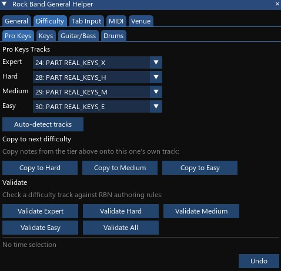
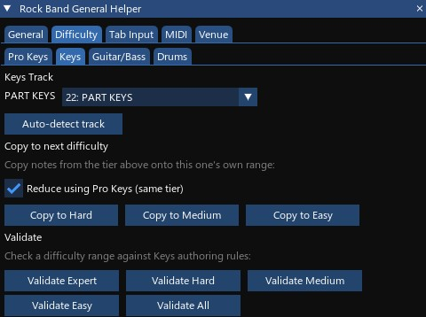
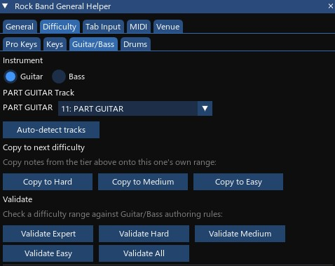
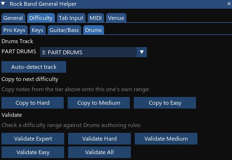
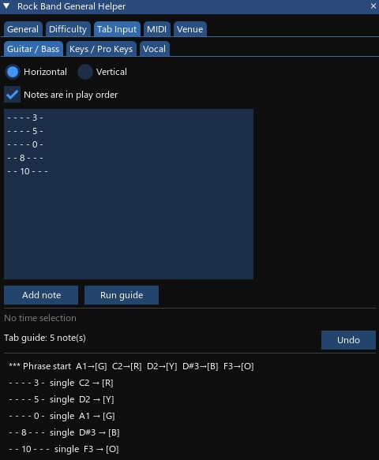
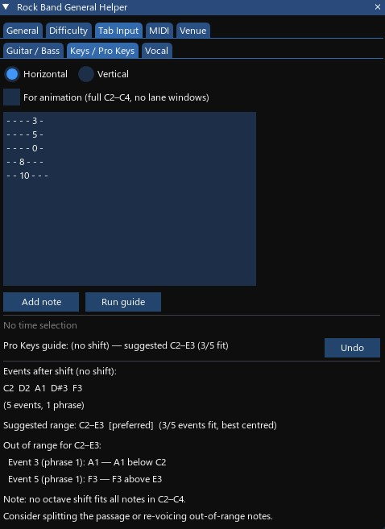
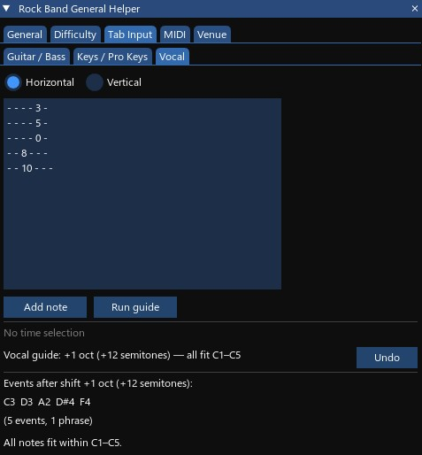
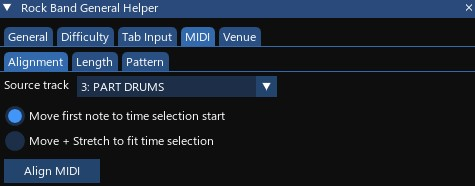
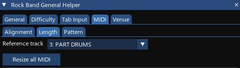
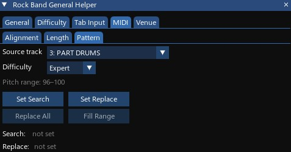

# Rock Band Instrument Helper

← [Back to overview and installation](../README.md)

**Instrument part authoring for custom songs in REAPER.** A REAPER ReaScript for the Guitar, Bass, Drums, Keys and Pro Keys parts: building and validating the lower difficulties, overdrive and drum fills, tab-input reference guides, and MIDI alignment/pattern tools. Five always-visible tabs plus three experimental (work-in-progress) tabs.

These tabs used to be part of the [General Helper](../rock_band_general_helper_vkr/README.md), which keeps the song-wide tools (audio alignment, tempo map, workflow checklist, VENUE and metadata). The two can be open side by side.

---

## Quick start

1. Open a REAPER project with your Expert charts on the usual `PART ...` tracks.
2. Run the script. The window opens with five tabs: **General | Difficulty | Overdrive | Tab Input | MIDI**.
3. Try **Difficulty → Generate** to build Hard, Medium and Easy from Expert, then **Validate** them in the instrument's own sub-tab.
4. **Drums**, **Keys** and **Guitar** are experimental and hidden by default — enable them via General → Settings → **Show WIPs?** (see [README_WIP.md](README_WIP.md) for their full documentation).

---

## UI overview

The window is organized into tabs plus a status panel at the bottom. Five tabs are always visible; three more (Drums, Keys, Guitar) are work-in-progress and hidden until enabled.

| Tab            | Purpose                                                                              |
| -------------- | ------------------------------------------------------------------------------------ |
| **General**    | Refresh tracks, remove 2x kicks, settings save/load, and buttons that open the other tools |
| **Difficulty** | Generate, copy and validate Pro Keys / Keys / Guitar-Bass / Drums tracks at each difficulty level |
| **Overdrive**  | Generate overdrive phrases, unisons, drum fills and vocal overdrive, and validate what is already authored |
| **Tab Input**  | Reference guide: parse ASCII tab notation for Guitar/Bass, Keys/Pro Keys, or Vocal  |
| **MIDI**       | Align, length-sync, or find-and-replace patterns on MIDI items                      |

| WIP tab (hidden by default) | Purpose                                                            |
| ---------------------------- | ------------------------------------------------------------------ |
| **Drums**                    | Convert GM MIDI drum notes to Rock Band 5-lane format               |
| **Keys**                     | Convert piano MIDI to Rock Band Pro Keys, 5-Lane Keys, or split into hand tracks |
| **Guitar**                   | Convert raw guitar MIDI pitches to Rock Band Expert gem notes       |

These three function at a basic level but have known issues and aren't ready for general use. Enable them via **Show WIPs? = Yes** in General → Settings; they appear after MIDI in the tab bar. Full documentation for these tabs lives in **[README_WIP.md](README_WIP.md)**.

The bottom of the window always shows the active time selection (or "No time selection") and the result panel from the last action.

---

## General tab

Contains three sub-tabs: **Actions**, **Settings**, and **Other tools**.

### Actions sub-tab

#### Refresh tracks

Re-scans the project's track list to pick up any tracks added or renamed after the script opened.

#### Drums 2x kicks

**Remove 2x kicks** works out which kicks on **PART DRUMS_2X** are the drummer's second foot and removes those from **PART DRUMS**. PART DRUMS_2X is the complete chart — every kick, double-bass hits included — and is never thinned; PART DRUMS ends up as the same chart playable with one pedal. Author every kick on both tracks, then press it. The whole track is processed (a time selection does not narrow it), and running it again finds nothing more to remove. The button's tooltip explains exactly which kicks count as the second foot.

### Settings sub-tab

**Show WIPs?** — toggles whether the Drums, Keys and Guitar tabs appear (see [WIP tabs](#wip-tabs)). Default No.

**Save** writes this window's settings to the project using REAPER's project state. **Load** restores them. Settings are loaded automatically when the script opens (if a save exists) and when you switch REAPER project tabs. They are saved separately from the General Helper's, so saving in one never changes the other.

**What is saved:** the Overdrive tab's options, the Tab Input format and mode, the Difficulty tab's Guitar/Bass choice and Keys reduce checkbox, the MIDI Alignment mode and Length settings, the WIP tabs' options, and Show WIPs?.

**What is not saved:** track selections (they are re-detected by name on each open and project switch) and Difficulty > Generate's choices, which last for the session.

### Other tools sub-tab

Buttons that open the other tools in this set — the General Helper, Vocal Helper and Music Theory Helper, and the standalone windows — so you don't have to go back to REAPER's Actions list to switch between them. It works exactly like the [General Helper's Other tools sub-tab](../rock_band_general_helper_vkr/README.md#other-tools-sub-tab); the Instrument Helper itself isn't listed, since you're already in it.

---

## Difficulty tab

Contains four sub-tabs: **Pro Keys**, **Keys**, **Guitar/Bass**, and **Drums**. Each has the same two rows:

- **Copy to Hard / Medium / Easy** — actually writes notes: copies from the immediately higher tier (Copy to Hard ← Expert, Copy to Medium ← Hard, Copy to Easy ← Medium) onto the target tier's own track/range, giving you a real starting point to hand-reduce rather than a read-only suggestion. If the source tier has no notes, it does nothing and reports that; if the target tier already has notes, a confirmation popup asks before clearing and overwriting them. Pro Keys is the one exception — it copies its whole note set (gems and lane-shift markers alike) verbatim, since the markers aren't optional there.
- **Validate Expert / Hard / Medium / Easy / All** — checks the actually-authored notes in that difficulty's own pitch range against RBN rules (read-only). Also cross-checks against the tier above and flags an un-reduced copy (identical note count/shape) so you know the difficulty still needs work.

All actions respect time selection.

### Pro Keys sub-tab

Validates PART REAL_KEYS_X/H/M/E (one track per difficulty, auto-detected by name). Checks chord count/span, interval jumps, spacing (Medium/Easy), and lane range markers. Only notes in the playable C2–C4 range are read as chord/gem events.

### Keys sub-tab

Validates PART KEYS, which carries all four difficulties in separate pitch ranges:

| Difficulty | Pitch range |
| ---------- | ----------- |
| Expert     | 96–100      |
| Hard       | 84–88       |
| Medium     | 72–75       |
| Easy       | 60–62       |

Checks chord count, spacing, note length, and sustain gaps. A **Reduce using Pro Keys (same tier)** checkbox (on by default) makes Copy to Hard/Medium/Easy keep only the copied events that land on a note in the matching-tier Pro Keys track — mirroring a reduction you've already hand-charted on Pro Keys onto the Keys copy — instead of copying every event from the tier above unfiltered.

### Guitar/Bass sub-tab

An instrument radio switch validates either PART GUITAR or PART BASS (Guitar and Bass share one rule set). Checks chord count/shape (per-difficulty max span), note length, overlap, sustain gaps, an advisory note-density check, force-HOPO markers, and trill/tremolo marker velocity. Pitch ranges: Expert 96–100, Hard 84–88, Medium 72–75 (no Orange), Easy 60–62 (Green/Red/Yellow only).

### Drums sub-tab

Validates PART DRUMS (Expert 96–100, Hard 84–88, Medium 72–76, Easy 60–64). Checks base chord/kick-pairing rules plus a set of layered density and grid rules that cascade from Hard down through Medium and Easy, and shows a block of non-pass/fail authoring hints for the more qualitative RBN guidance (e.g. "favor crash over kick" on Easy).

---

## Tab Input tab

A **reference guide, not a converter** — every mode here parses ASCII tab text and reports the resulting gem/pitch assignment in the result panel. Nothing is ever written to the project. Use the Guitar, Keys, or Drums tabs (or hand-authoring) to actually write notes; use Tab Input to plan chord shapes and check range/spacing before you do.

Three sub-tabs — **Guitar / Bass**, **Keys / Pro Keys**, **Vocal** — share the same input area:

### Accepted formats

- **Horizontal tab** — one line per event, six space-separated tokens (fret number, or `-`/`x` for unplayed), left = lowest string (E) up to right = highest (e). This is standard chord notation: `x 3 2 0 1 0` is C major. Multi-digit frets are supported; a blank line marks a phrase break.
- **Vertical tab** — six rows (one per string), standard ASCII tab layout so the top row is the high e and the bottom the low E. Space-separated tokens per row, columns read left-to-right as events; an all-dash column marks a phrase break.

The two formats run in opposite directions because the two notations really are written that way — a one-line fret shape starts at the low E, ASCII tab puts the high e on top. Both match how you'd find them printed anywhere else, so neither is the odd one out.

**Add note** appends an empty slot to the input (an all-dash line/column) — it doesn't touch the project either.

### Guitar / Bass

**Run guide** reports the per-event gem assignment and reasoning. Each chord is classified whole, by its distinct **pitch classes** — the gem count follows from the harmony (2 for a dyad, 3 for a real triad), never from how many strings were struck, so octave doublings don't consume a gem. A power chord always gets a matching 1-3 lane spread whether it's voiced on two strings or five, and the report calls out the recognized chord name. This is the same analysis the Music Theory helper's **Shape Search** performs, and the two tools agree on every shape.

Chord-shape ranking then assigns lane position by pitch (higher pitch trends toward Orange, lower toward Green, mirroring real fretboard hand movement). When a passage has more distinct shapes than available lane combos, the shapes that appear first each claim their own combo; any later shape reuses whichever combo it conflicts with the least, based on which chords are actually back-to-back in the passage — two genuinely adjacent chords only ever end up looking identical when it's truly unavoidable, flagged with `(*Wrap)` in the report.

The Guitar tab converter's **Max chord**, **Allow 1-4**, and **Phrase gap** settings do not apply here — this tab writes nothing, so there is nothing to fit to a chart. Phrase breaks come from blank lines in the tab input.

### Keys / Pro Keys

An extra **"For animation (full C2–C4, no lane windows)"** checkbox: off scores against a 10th-wide Pro Keys lane window and suggests the best lane range; on scores against the full C2–C4 range instead (for planning `PART KEYS_ANIM_RH/LH` notes). **Run guide** finds the best octave shift to fit the notes into C2–C4 (MIDI 48–72), lists anything still out of range, and flags chords wider than the 12-semitone Expert max.

### Vocal

**Run guide** finds the best octave shift to fit the notes into the wider C1–C5 vocal range (MIDI 36–84), lists anything still out of range, and flags overly wide chords. Blank lines separate phrases.

---

## MIDI tab

Three sub-tabs: **Alignment**, **Length**, and **Pattern**.

### Alignment sub-tab

Aligns a single imported MIDI item to the project grid.

#### Modes

- **Move only** — shifts the item so its first note lands at the time selection start. Useful for rough alignment when tempo is known.
- **Move + Stretch** — also adjusts the take playback rate so the last note aligns with the time selection end. Use this when the MIDI was recorded at a slightly different tempo and needs to stretch to fit the project grid.

#### Workflow

1. Set a time selection over the target range.
2. Select the source track in the dropdown.
3. Click **Align MIDI**.

The result panel reports the shift amount in milliseconds and, when stretching, the playback rate change. Fully undoable.

### Length sub-tab

Resizes MIDI items to match a reference track's length — useful after aligning several imported MIDI tracks whose items ended up different lengths.

1. Select the **Reference track** — the MIDI track already sized to the full song length.
2. Click **Resize all MIDI**.

For every other track, the first MIDI item is resized (its right edge moved) to match the reference item's length exactly — notes are never moved or deleted. Items that don't start at project position 0 are skipped and reported (those are Alignment's job, not Length's). Fully undoable; the result warns if any item was shrunk, so you can verify no notes were cut off.

### Pattern sub-tab

Finds and replaces a recurring note pattern across a MIDI track, or tiles a pattern across a range.

1. Select the **Source track**.
2. Make a time selection over an example of the pattern you want to search for, then click **Set Search** to capture it.
3. Make a time selection over the pattern you want to replace it with, then click **Set Replace** to capture it. Both patterns must span the same duration — if they don't, **Replace All** refuses to run and tells you so; re-capture whichever one is wrong. Capturing one never clears the other.
4. Click **Replace All** to scan the track (within the time selection if one is active, otherwise the whole item) and swap in the Replace pattern wherever the Search pattern matches exactly (same pitches, same relative timing).
5. Or click **Fill Range** to tile the Replace pattern repeatedly across the current time selection — no Search pattern needed.

A live readout under the buttons shows what's currently captured (e.g. "M4–M6 (2 measures with 5 notes)" or "not set"). All actions are fully undoable.

#### Standalone MIDI Pattern window

`rock_band_midi_pattern_vkr.lua` (repo root) is a separate script that opens just this sub-tab in its own window — load it the same way as the main scripts (**Actions → Show action list → Load ReaScript**), or click **MIDI Pattern** in [General → Other tools](#other-tools-sub-tab). Handy for keeping it beside REAPER's MIDI editor without the helper's other tabs coming along. Same underlying behavior as above, plus its own **Refresh tracks** button (the main window keeps that in General → Actions) and its own status line with an Undo button.

It has no settings of its own to save — this sub-tab has never had any — and switching REAPER projects clears the captured Search and Replace patterns rather than leaving them pointing at the previous project's MIDI item.
